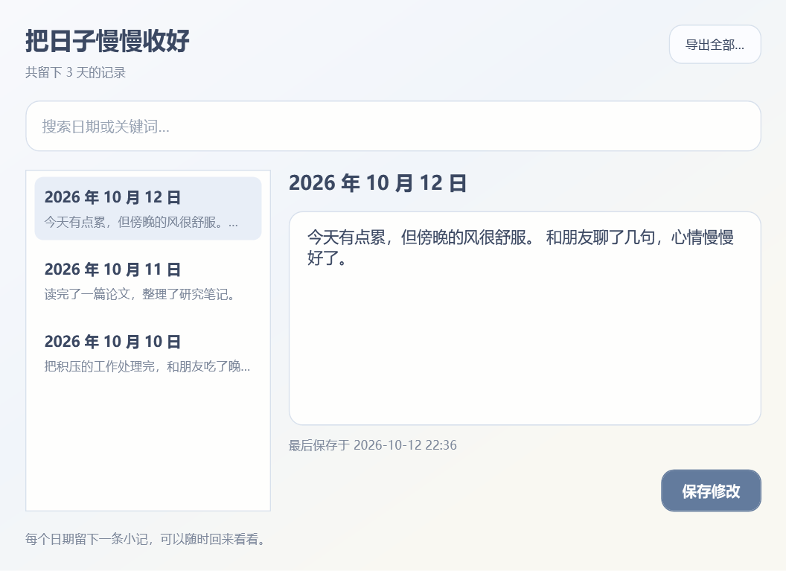

# 每日一记吧

睡前用两三句话记下今天的事或心情，保存后安心关机。

一个离线的 Windows 桌面小工具：打开窗口、写下记录、点击「保存并关机」，记录写入本机后开始 10 秒倒计时。也可以只保存，继续使用电脑。


## 下载与使用

进入本仓库右侧的 **Releases**，下载最新版的 **`DailyReflection-v1.1.1-windows-portable.zip`**。后续版本的文件名会带上对应版本号。

1. 将 ZIP 解压到一个有写入权限、便于长期保存的文件夹。
2. 双击 **`每日一记吧.exe`**。保留旁边的 `.exe.config` 文件。
3. 写下今天的事或心情，选择 **保存并关机** 或 **只保存**。
4. 可以右键点击程序的任务栏图标，选择 **固定到任务栏**，以后每天从这里打开。

ZIP 包无需安装。Windows 10 / 11，.NET Framework 4.7.2 或更高版本；不需要 Python、Visual Studio 或开发工具。ARM 设备尚未验证。

GitHub 自动提供的 **Source code (zip)** 和 **Code → Download ZIP** 是源码包。直接使用软件请下载上面带 `windows-portable` 的发布包。

## 功能

- 每天保存一条记录，当天再次保存会更新当天内容。
- 历史记录支持日期、关键词筛选、修改和导出 Markdown。
- 保存成功后开始 10 秒关机倒计时，可点击取消、按 Esc 或关闭窗口取消。
- 每次打开输入框为空，已保存的记录留在历史记录中。
- 30 条内置诗句，显示作者，鼠标停留可查看作品名；毛泽东诗词抽取概率为 60%，其他作者合计 40%。
- 完全离线，无账号、无云端同步。

请每天从这个程序的入口开始关机。当前版本在点击「保存并关机」时请求 Windows 正常关机，未接入 Windows 开始菜单的关机入口。

完整操作、备份和恢复方法见 [使用说明](docs/使用说明.md)。



## 数据与备份

记录保存在程序旁边的 `数据/entries.json`，首次保存时创建。复制整个 `数据` 文件夹即可备份。更新版本前备份数据，解压新版后将原来的 `数据` 文件夹复制到新程序旁边。

记录为本机明文文件。写入失败不会启动关机；记录文件损坏时保留原文件，并提示检查备份。关机使用正常关闭流程，其他软件有未保存内容时，Windows 可能要求先处理这些文件。

## 从源码构建

在 Windows 上打开 PowerShell，进入仓库目录，运行：

```powershell
powershell -NoProfile -ExecutionPolicy Bypass -File .\build.ps1 -Verify
```

程序生成到 `bin/每日一记吧.exe`，配置文件同时生成。脚本使用 Windows 自带的 .NET Framework C# 编译器和 WPF，不下载 NuGet 包。图标已包含；只有重新生成图标才需要 Python 和 Pillow。

验证模式使用模拟关机服务，测试记录写入独立的 `artifacts` 目录。报告在 `artifacts/test-results.txt`，验证不会执行真实关机。

生成经过验证的便携发布包和 SHA-256 校验文件：

```powershell
powershell -NoProfile -ExecutionPolicy Bypass -File .\package.ps1
```

输出位于 `dist/`。打包只收录程序、配置、使用说明和许可声明。日记数据、测试数据和本机快捷方式不进入发布包；`.gitignore` 同时排除这些文件。

GitHub Actions 会在代码提交、拉取请求和手动运行时构建、验证并保存发布包为构建产物。对外提供下载时，将 ZIP 和 `.sha256` 上传到 **Releases**。

首次上传步骤见 [GitHub 发布指南](docs/GitHub发布指南.md)，可直接复制的版本说明见 [v1.1.1 发布说明](docs/RELEASE-v1.1.1.md)。

## 许可与参考

项目源码采用 [MIT License](LICENSE)。关机与保持唤醒机制参考 [Shutdown Timer Classic](https://github.com/lukaslangrock/ShutdownTimerClassic)，其 MIT 许可及作者声明保留在 [THIRD-PARTY-NOTICES.txt](THIRD-PARTY-NOTICES.txt)。内置诗句的作者及作品名保留在 `src/Poems.cs`。
